# Lab9_ST

## Exercício 1 - Situação do Aluno

### a) Cobertura de ramos e mutmut

Suíte inicial: `classificar_aluno(8.0, 80) == "Aprovado"` e `classificar_aluno(3.0, 90) == "Reprovado"`.

```
pytest -q --cov=src --cov-branch --cov-report=term-missing
```

```
Name                   Stmts   Miss Branch BrPart  Cover   Missing
src/classificacao.py      12      4     10      4    64%   3, 5, 7, 11
```

A suíte não executa as linhas 3, 5, 7 e 11.

```
mutmut run
mutmut results --all true
```

```
36/36  🎉 6  🫥 0  ⏰ 0  🤔 0  🙁 30  🔇 0  🧙 0
```

| Mutantes | Quantidade |
|---|---|
| Gerados | 36 |
| Mortos | 6 (#26, #27, #28, #34, #35, #36) |
| Vivos | 30 |

MS inicial = 6/36 ≈ 17%.


### b) Vivos agrupados pela causa

Linhas que a suíte **não executa**: 3, 5, 7 e 11 (coluna `Missing` do pytest-cov no item a).

| Causa | Vivos | Quais | Por quê |
|---|---|---|---|
| **Alcançar** | 14 | #6–9 (linha 3), #15–18 (linha 5), #21–23 (linha 7), #31–33 (linha 11) | a suíte nunca executa essas linhas: não há entrada inválida, nem presença abaixo de 75, nem média na recuperação |
| **Infectar** (`or` virou `and`) | 2 | #1 (linha 2), #10 (linha 4) | só há entradas válidas, e com elas `or` e `and` dão o mesmo resultado |
| **Infectar** (fronteiras e constantes) | 14 | #2–5 (linha 2), #11–14 (linha 4), #19–20 (linha 6), #24–25 (linha 8), #29–30 (linha 10) | as linhas executam, mas nenhum valor de fronteira (0, 10, 75, 7.0, 5.0) separa o original do mutante |

Total: 14 + 2 + 14 = 30 vivos.

**Vivos em linhas que a suíte nem executa:** os 14 do grupo Alcançar (linhas 3, 5, 7 e 11).


### c) Suíte melhorada

Testes acrescentados em `test_classificacao.py`:

| Teste | Entradas | Mutantes que mata |
|---|---|---|
| Fronteiras da média | (0, 80), (10, 80), (7.0, 80), (6.9, 80), (5.0, 80), (4.9, 80) | `<` e `>` trocados, constantes das linhas 2, 8 e 10; mensagem "Recuperacao" |
| Fronteiras da presença | (8.0, 0), (8.0, 74), (8.0, 75), (8.0, 100) | constantes das linhas 4 e 6; mensagem "Reprovado por falta" |
| Média inválida | -1, -0.1, 10.1, 11 | `or` virou `and`, `> 11`, mensagem da linha 3 |
| Presença inválida | -1, -0.1, 100.1, 101 | `or` virou `and`, `> 101`, mensagem da linha 5 |

As mensagens são conferidas com `str(erro.value) == "..."`.


**Algum mutante é equivalente?** Nenhum. Todo mutante tem uma entrada que o diferencia do original (por exemplo, `media = 0` mata `<= 0` e `< 1`, `presenca = 75` mata `<= 75` e `< 76`, e `7.0` e `5.0` matam os `>`).

**MS final** = 36/36 = **100%** (antes: 6/36 ≈ 17%).

### d) `pytest.raises(ValueError, match=msg)`

Troca feita nos testes de entrada inválida:

```python
with pytest.raises(ValueError, match="Media invalida"):
    classificar_aluno(media, 80)
```


Os mutantes #7 e #16 passaram a sobreviver (`"XXMedia invalidaXX"` e `"XXPresenca invalidaXX"`). MS = 34/36 ≈ **94%**.

**O que muda:** o `match` usa `re.search`, então basta a mensagem **conter** o texto esperado, e o mutante com `XX` antes e depois ainda passa. Os demais mutantes de mensagem continuam mortos (o `None` não contém o texto e o `match` diferencia maiúsculas de minúsculas). Com a conferência por igualdade (`==`), isso não acontecia.

**Correção:** ancorar a expressão com `^` e `$`:

```python
match="^Media invalida$"
match="^Presenca invalida$"
```


MS volta a **100%**.

## Exercício 2: Desconto progressivo

### a) Cobertura de ramos e MS da suíte inicial

Suíte inicial: `assert total_com_desconto([10, 20, 30, 40, 50]) > 0`.

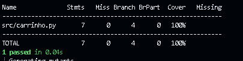

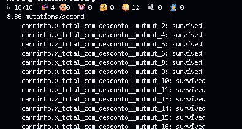

Cobertura de ramos: **100%**. Mutantes gerados: 16, mortos: 4, vivos: 12. MS = 4/16 = **25%**.

**O que os dois números dizem:** a cobertura só mede que o código foi *executado*, não que o resultado foi *verificado*. O assert `> 0` aceita quase qualquer valor, então a suíte passa por todas as linhas sem conferir nenhuma. O MS de 25% mostra isso.

### b) Assert exato

Troca feita (a entrada não mudou; a conta é 10 + 20 + 30 + 36 + 45 = 141):

```python
def test_total_exato():
    assert total_com_desconto([10, 20, 30, 40, 50]) == 141.0
```

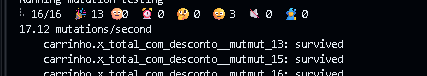

Restam **3 vivos**, todos na linha `return round(total, 2)`. MS = 13/16 ≈ **81%**.

### c) Condição que falhou em cada vivo


| Mutante | Mudança | Alcançar | Infectar | Propagar | Revelar |
|---|---|---|---|---|---|
| #13 | `round(total, None)` | sim | sim (vira `int`: 141 em vez de 141.0) | sim (é o retorno) | **não**: `141 == 141.0` é `True` |
| #15 | `round(total, )` | sim | sim (vira `int`) | sim | **não**, mesmo motivo |
| #16 | `round(total, 3)` | sim | **não**: `round(141.0, 3)` é `141.0`, idêntico ao original | não | não |

Nos mutantes #13 e #15 o estado é alterado e chega à saída, mas o `==` do Python trata `141` e `141.0` como iguais, então o assert não **revela** a diferença. No #16 o estado nem chega a ser alterado, porque 141.0 não tem casas além da segunda: falha a condição de **infectar**.

### d) Entrada acrescentada

```python
def test_preco_com_centavos_exige_arredondamento():
    # 60 + 12.34 * 0.9 = 71.106 -> 71.11 (duas casas)
    assert total_com_desconto([10, 20, 30, 12.34]) == 71.11
```

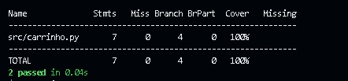


**Que tipo de preço foi preciso:** um preço com **centavos quebrados**, de modo que o total tenha mais de duas casas decimais antes de arredondar. Com isso, `round(..., 3)` dá 71.106 e `round(...)` sem o 2 dá 71, e ambos deixam de coincidir com 71.11.

**MS final** = 16/16 = **100%** (antes: 4/16 = 25%).

---

## Exercício 3: Temperaturas da semana

### a) Suíte inicial e vivos

Suíte: listas `[21, 25, 19, 30, 22]`, `[18]` e `[30, 21]` com o valor exato, e lista vazia com `pytest.raises(ValueError)` sem conferir a mensagem, para as duas funções (8 testes).

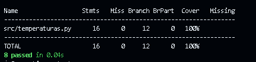


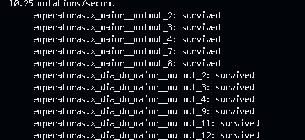

Cobertura de ramos 100%, 22 mutantes, 11 mortos, 11 vivos. MS = 11/22 = **50%**.

Vivos encontrados:

| Mutante | Mudança |
|---|---|
| `maior` #2, #3, #4 | mensagem vira `None`, `"XXlista vaziaXX"`, `"LISTA VAZIA"` |
| `maior` #7 | `temps[1:]` vira `temps[2:]` |
| `maior` #8 | `t > m` vira `t >= m` |
| `dia_do_maior` #2, #3, #4 | as mesmas três mensagens |
| `dia_do_maior` #9 | `range(1, len(temps))` vira `range(len(temps))` |
| `dia_do_maior` #11 | `range(1, len(temps))` vira `range(2, len(temps))` |
| `dia_do_maior` #12 | `temps[i] > temps[pos]` vira `>=` |

### b) Classificação dos vivos

| Mutante | Classe | Justificativa |
|---|---|---|
| `maior` #2, #3, #4 e `dia_do_maior` #2, #3, #4 | Não equivalentes | A suíte nunca confere a mensagem; um teste com `match` distingue cada uma |
| `maior` #7 | Não equivalente | Se o maior estiver na posição 1, ele é ignorado: `[10, 40, 20]` devolve 20 em vez de 40 |
| `maior` #8 | **Equivalente** | `t >= m` só troca `m` por um `t` igual a ele; o valor devolvido é o mesmo para qualquer entrada |
| `dia_do_maior` #9 | **Equivalente** | Com `i = 0` a comparação é `temps[0] > temps[0]`, sempre falsa, então `pos` nunca muda nessa volta |
| `dia_do_maior` #11 | Não equivalente | Ignora a posição 1: `[10, 40, 20]` devolve 0 em vez de 1 |
| `dia_do_maior` #12 | Não equivalente | Em empate devolve o último dia em vez do primeiro: `[30, 21, 30]` devolve 2 em vez de 0 |

### c) Mutantes não equivalentes mortos

Testes acrescentados/alterados:

```python
def test_maior_maximo_na_posicao_1():
    assert maior([10, 40, 20]) == 40


def test_maior_vazia():
    with pytest.raises(ValueError, match="^lista vazia$"):
        maior([])


def test_dia_do_maior_maximo_na_posicao_1():
    assert dia_do_maior([10, 40, 20]) == 1


def test_dia_do_maior_empate_devolve_o_primeiro():
    assert dia_do_maior([30, 21, 30]) == 0


def test_dia_do_maior_vazia():
    with pytest.raises(ValueError, match="^lista vazia$"):
        dia_do_maior([])
```

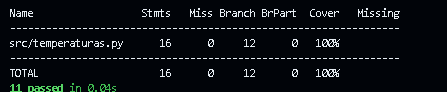

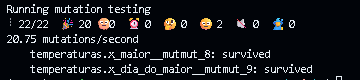

Os dois vivos restantes são os equivalentes justificados em (b).

- **MS antes** = 11/22 = **50%**
- **MS depois** = 20/(22 − 2) = **100%**

### d) Por que `>` virar `>=` é equivalente numa função e não na outra

- Em **`maior`**, a função devolve o *valor* do maior. Se `t == m`, trocar `m` por `t` não muda nada, porque os dois são iguais. Nenhuma entrada distingue as duas versões: mutante equivalente.
- Em **`dia_do_maior`**, a função devolve a *posição*. Em um empate, o `>=` atualiza `pos` para o índice do empate, e a especificação pede o **primeiro** dia com a maior temperatura. Com `[30, 21, 30]` o original devolve 0 e o mutante devolve 2: mutante não equivalente.

O operador mutado é o mesmo, mas a equivalência depende do **que a função devolve** e do **que a especificação exige**.

---

## Exercício 4: Parcelamento

### a) Suíte derivada por valor-limite

Os valores de `n` vêm das fronteiras da especificação: o intervalo válido (1 a 12) e a mudança de regime dos juros (3 para 4). Os valores esperados saem da fórmula `valor * (1 + 0,02 * (n - 3)) / n`, não do código.

| n | Motivo | Esperado (valor = 100) |
|---|---|---|
| 0 | logo abaixo do mínimo | `ValueError("parcelas invalidas")` |
| 1 | menor válido | 100.0 |
| 2 | sem juros | 50.0 |
| 3 | última parcela sem juros | 33.33 |
| 4 | primeira com juros | 100 × 1,02 / 4 = 25.5 |
| 12 | maior válido | 100 × 1,18 / 12 = 9.83 |
| 13 | logo acima do máximo | `ValueError("parcelas invalidas")` |

```python
@pytest.mark.parametrize("n", [0, 13])
def test_parcelas_invalidas(n):
    with pytest.raises(ValueError, match="^parcelas invalidas$"):
        parcela(100, n)


@pytest.mark.parametrize("valor, n, esperado", [
    (100, 1, 100.0),
    (100, 2, 50.0),
    (100, 3, 33.33),
    (100, 4, 25.5),
    (100, 12, 9.83),
])
def test_parcela_nas_fronteiras(valor, n, esperado):
    assert parcela(valor, n) == esperado
```


### b) Cobertura de ramos e MS

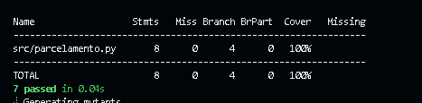

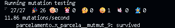

Cobertura de ramos 100%, 27 mutantes, 26 mortos, 1 vivo. MS = 26/27 ≈ **96,3%**.

### c) Análise do vivo

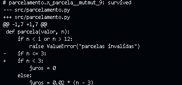

O vivo é o **mutmut_9**: `if n <= 3` vira `if n < 3`.

**É equivalente.** As duas versões só diferem em `n = 3`. No original, `n = 3` entra no `if` e `juros = 0`. No mutante, `n = 3` cai no `else` e `juros = 0.02 * (3 - 3) = 0`. O `juros` é o mesmo nos dois casos, então a saída é idêntica para qualquer entrada, e nenhum teste consegue matá-lo.

Não foi preciso acrescentar testes. **MS final** = 26/(27 − 1) = **100%**.

