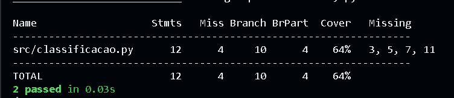
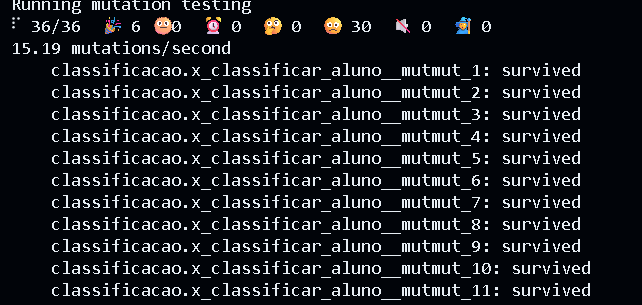
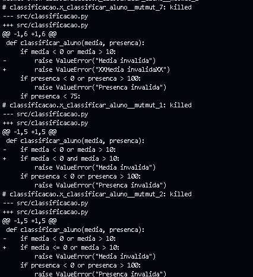
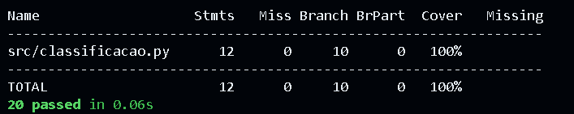
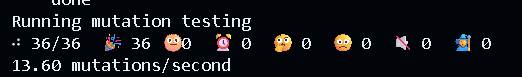
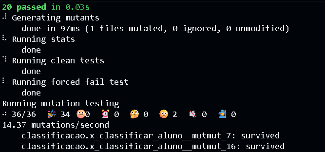
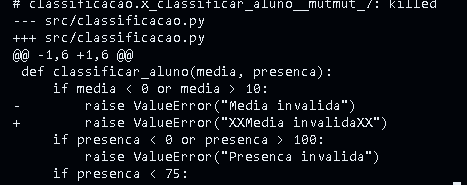
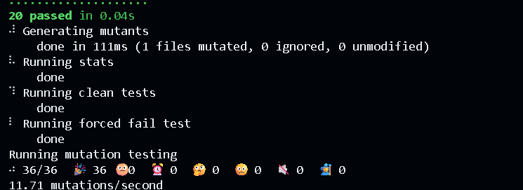

# Lab9_ST

## Exercício 1 - Situação do Aluno

### a) Cobertura de ramos e mutmut

Suíte inicial: `classificar_aluno(8.0, 80) == "Aprovado"` e `classificar_aluno(3.0, 90) == "Reprovado"`.

```
pytest -q --cov=src --cov-branch --cov-report=term-missing
```

```
Name                   Stmts   Miss Branch BrPart  Cover   Missing
src/classificacao.py      12      4     10      4    64%   3, 5, 7, 11
```

A suíte não executa as linhas 3, 5, 7 e 11.

```
mutmut run
mutmut results --all true
```

```
36/36  🎉 6  🫥 0  ⏰ 0  🤔 0  🙁 30  🔇 0  🧙 0
```

| Mutantes | Quantidade |
|---|---|
| Gerados | 36 |
| Mortos | 6 (#26, #27, #28, #34, #35, #36) |
| Vivos | 30 |

MS inicial = 6/36 ≈ 17%.





### b) Vivos agrupados pela causa

Linhas que a suíte **não executa**: 3, 5, 7 e 11 (coluna `Missing` do pytest-cov no item a).

| Causa | Vivos | Quais | Por quê |
|---|---|---|---|
| **Alcançar** | 14 | #6–9 (linha 3), #15–18 (linha 5), #21–23 (linha 7), #31–33 (linha 11) | a suíte nunca executa essas linhas: não há entrada inválida, nem presença abaixo de 75, nem média na recuperação |
| **Infectar** (`or` virou `and`) | 2 | #1 (linha 2), #10 (linha 4) | só há entradas válidas, e com elas `or` e `and` dão o mesmo resultado |
| **Infectar** (fronteiras e constantes) | 14 | #2–5 (linha 2), #11–14 (linha 4), #19–20 (linha 6), #24–25 (linha 8), #29–30 (linha 10) | as linhas executam, mas nenhum valor de fronteira (0, 10, 75, 7.0, 5.0) separa o original do mutante |

Total: 14 + 2 + 14 = 30 vivos.

**Vivos em linhas que a suíte nem executa:** os 14 do grupo Alcançar (linhas 3, 5, 7 e 11).



### c) Suíte melhorada

Testes acrescentados em `test_classificacao.py`:

| Teste | Entradas | Mutantes que mata |
|---|---|---|
| Fronteiras da média | (0, 80), (10, 80), (7.0, 80), (6.9, 80), (5.0, 80), (4.9, 80) | `<` e `>` trocados, constantes das linhas 2, 8 e 10; mensagem "Recuperacao" |
| Fronteiras da presença | (8.0, 0), (8.0, 74), (8.0, 75), (8.0, 100) | constantes das linhas 4 e 6; mensagem "Reprovado por falta" |
| Média inválida | -1, -0.1, 10.1, 11 | `or` virou `and`, `> 11`, mensagem da linha 3 |
| Presença inválida | -1, -0.1, 100.1, 101 | `or` virou `and`, `> 101`, mensagem da linha 5 |

As mensagens são conferidas com `str(erro.value) == "..."`.





**Algum mutante é equivalente?** Nenhum. Todo mutante tem uma entrada que o diferencia do original (por exemplo, `media = 0` mata `<= 0` e `< 1`, `presenca = 75` mata `<= 75` e `< 76`, e `7.0` e `5.0` matam os `>`).

**MS final** = 36/36 = **100%** (antes: 6/36 ≈ 17%).

### d) `pytest.raises(ValueError, match=msg)`

Troca feita nos testes de entrada inválida:

```python
with pytest.raises(ValueError, match="Media invalida"):
    classificar_aluno(media, 80)
```





Os mutantes #7 e #16 passaram a sobreviver (`"XXMedia invalidaXX"` e `"XXPresenca invalidaXX"`). MS = 34/36 ≈ **94%**.

**O que muda:** o `match` usa `re.search`, então basta a mensagem **conter** o texto esperado, e o mutante com `XX` antes e depois ainda passa. Os demais mutantes de mensagem continuam mortos (o `None` não contém o texto e o `match` diferencia maiúsculas de minúsculas). Com a conferência por igualdade (`==`), isso não acontecia.

**Correção:** ancorar a expressão com `^` e `$`:

```python
match="^Media invalida$"
match="^Presenca invalida$"
```



MS volta a **100%**.

